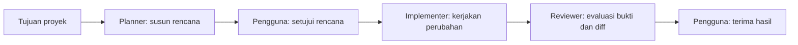
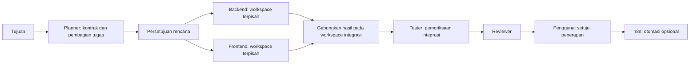
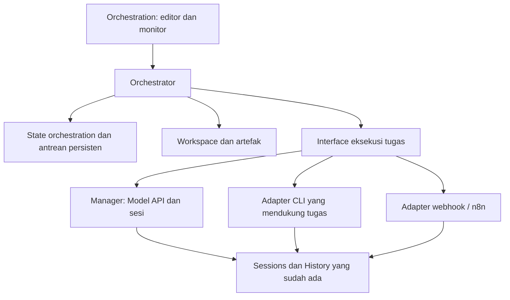

# Rencana fitur Orchestration Agent Dock

Status: usulan untuk dibahas, belum implementasi. Disusun berdasarkan kode proyek pada 20 Oktober 2026. Istilah mengacu ke [GLOSSARY.md](../GLOSSARY.md).

## 1. Hasil yang ingin dicapai

Pengguna memilih proyek, menetapkan tujuan, menyusun workflow, menentukan agent dan tugas setiap langkah, lalu menjalankan workflow dari Agent Dock. Sistem menyerahkan hasil antarlangkah, menegakkan ketergantungan, dan menampilkan pekerjaan serta keputusan yang masih perlu ditangani pengguna.

Contoh: "Tambahkan fitur login pada aplikasi ini" menghasilkan rencana, implementasi, laporan pemeriksaan, review, dan perubahan yang siap disetujui. Semua agent mengerjakan tujuan proyek yang sama dengan ruang kerja dan konteks yang ditentukan.

Asumsi awal: aplikasi lokal untuk satu pengguna, koneksi CLI / Model API / webhook yang sudah tersedia tetap dipakai, n8n lokal bersifat opsional, dan eksekusi awal dipicu pengguna. Jadwal, webhook masuk untuk memulai proyek, dan penggunaan oleh beberapa pengguna masuk tahap lanjutan.

## 2. Landasan kode saat ini

| Bagian                    | Sudah tersedia                                                                    | Perubahan yang dibutuhkan                                                            |
| ------------------------- | --------------------------------------------------------------------------------- | ------------------------------------------------------------------------------------ |
| `shared/types.ts`         | Connector, Session, SessionRun, status, penggunaan                                | Tipe proyek, profil agent, definisi workflow, eksekusi tugas, percobaan, dan artefak |
| `server/manager.ts`       | Menjalankan PTY, model, webhook, callback, penghentian, persetujuan file          | Interface eksekusi tugas dengan identitas dan sinyal selesai yang dapat dipercaya    |
| `server/store.ts`         | Antrean penyimpanan atomik state JSON; sesi aktif menjadi stopped setelah restart | Penyimpanan transaksi untuk antrean dan pemulihan orchestration                      |
| `server/project-tools.ts` | Operasi file terbatas folder proyek dan persetujuan perubahan                     | Workspace per tugas dan kebijakan persetujuan yang eksplisit                         |
| `server/index.ts`         | REST, autentikasi browser lokal, callback per run, WebSocket                      | Route orchestration dan pembaruan status yang mempunyai urutan                       |
| `src/App.tsx`             | Koneksi, Sessions, History, detail terminal/percakapan                            | Halaman Orchestration terpisah dengan akses ke sesi pelaksana                        |
| n8n lokal                 | Webhook, callback terautentikasi, pertanyaan dan balasan telah diuji              | Kontrak langkah otomasi, hasil terstruktur, batas waktu, dan pelaporan kegagalan     |

Kesenjangan penting: `Session.status` belum merupakan kontrak keberhasilan tugas orchestration. CLI dapat tetap hidup setelah satu tugas selesai; proses keluar dengan kode nol juga belum membuktikan hasil memenuhi kriteria. `SessionRun` sekarang mencatat lifecycle sesi dan tidak sama dengan `WorkflowRun` atau `Attempt`.

Model API saat ini menyediakan tool file, bukan tool shell untuk menjalankan tes. Profil tester yang memerlukan eksekusi perintah harus dipasangkan dengan pelaksana yang mendukungnya. Dukungan PTY dan IDE juga tidak otomatis berarti pengiriman tugas serta penyelesaian terstruktur sudah didukung.

## 3. Bentuk pengalaman pengguna

Tambahkan menu utama **Orchestration**, berisi empat tampilan:

| Tampilan  | Fungsi                                                                                                           |
| --------- | ---------------------------------------------------------------------------------------------------------------- |
| Proyek    | Memilih folder / repositori, tujuan, konteks proyek, kebijakan perubahan, dan batas eksekusi                     |
| Agents    | Membuat profil peran dan memilih Connector, model, instruksi, kemampuan, serta batas paralel                     |
| Workflows | Membuat draft, menyusun langkah dan hubungan, mengatur tugas, memvalidasi, menyimpan versi, dan memakai template |
| Runs      | Memantau eksekusi, membaca hasil per langkah, menjawab pertanyaan, menyetujui tindakan, dan menangani kegagalan  |

Alur penggunaan:

1. Pilih atau buat proyek dari folder yang sudah ada.
2. Buat profil, misalnya Planner, Backend, Frontend, Tester, dan Reviewer. Nama dan jumlah peran bebas diatur.
3. Pilih template atau buat workflow kosong.
4. Hubungkan langkah, pilih profil agent, isi instruksi, masukan, keluaran, dan kriteria selesai.
5. Jalankan validasi dan pratinjau: tugas yang akan dikirim, agent pelaksana, kebutuhan akses, serta batas eksekusi.
6. Simpan versi dan mulai eksekusi. Pilihan model / profil dan versi workflow dibekukan untuk run itu.
7. Pantau canvas atau daftar langkah. Klik langkah untuk membaca tugas, sesi, artefak, pemeriksaan, dan penggunaan.
8. Tangani pertanyaan atau persetujuan. Hasil akhir berisi perubahan, bukti pemeriksaan, dan pekerjaan yang belum selesai.

Editor menyediakan canvas dan panel pengaturan di samping. Sediakan pula tampilan daftar agar alur tetap mudah diatur dengan keyboard dan pada layar kecil. Posisi simpul merupakan pengaturan tampilan; hubungan langkah dan aturan data merupakan definisi eksekusi.

## 4. Hal yang dapat diatur

| Cakupan      | Pengaturan                                                                                                                           |
| ------------ | ------------------------------------------------------------------------------------------------------------------------------------ |
| Proyek       | Tujuan, folder, acuan kode, dokumen konteks, aturan perubahan, dan batas paralel penulisan                                           |
| Profil agent | Nama peran, Connector, model bila didukung, instruksi, kemampuan yang dibutuhkan, dan batas paralel                                  |
| Langkah      | Tujuan tugas, profil agent, instruksi tambahan, artefak masukan, bentuk keluaran, kriteria selesai, timeout, dan kebijakan kegagalan |
| Workflow     | Ketergantungan, percabangan, penggabungan hasil, persetujuan, batas durasi / percobaan, dan parameter saat mulai                     |
| Eksekusi     | Nilai parameter, jawaban pengguna, keputusan persetujuan, pause, resume, cancel, serta retry yang diizinkan                          |

Satu Connector dapat dipakai beberapa profil agent. Contoh: koneksi Codex lokal menjalankan peran Backend dan Reviewer pada tugas serta sesi berbeda. Sistem menghitung batas paralel gabungan pada Connector agar peran berbeda tidak melewati kemampuan alat yang sama.

Tugas dapat memakai referensi seperti `inputs.goal` dan `steps.plan.outputs.apiContract`. Referensi divalidasi dan harus menunjuk keluaran yang tersedia di jalur tersebut. Hindari penyisipan seluruh riwayat chat secara otomatis; paket konteks berisi sumber yang dipilih dan menampilkan ukurannya.

Batas token yang tidak dilaporkan runtime ditampilkan sebagai tidak diketahui. Batas biaya berupa perkiraan sampai harga dan penggunaan aktual tersedia; batas keras yang dapat ditegakkan adalah jumlah tugas, percobaan, paralelisme, dan durasi. Keluaran yang terlalu besar meminta pengguna memilih konteks atau merangkum secara eksplisit.

## 5. Langkah dan aturan workflow

| Jenis langkah | Perilaku                                                                                          |
| ------------- | ------------------------------------------------------------------------------------------------- |
| Start         | Mendefinisikan parameter dan titik awal                                                           |
| Agent Task    | Mengirim satu tugas ke profil agent dan menghasilkan artefak                                      |
| Automation    | Memanggil webhook n8n atau otomasi lain melalui Connector                                         |
| Approval      | Menunggu keputusan pengguna atas rencana, tindakan, atau hasil tertentu                           |
| Condition     | Memilih jalur dari keluaran terstruktur atau hasil pemeriksaan                                    |
| Join          | Menunggu seluruh cabang yang diwajibkan dan mengumpulkan hasilnya                                 |
| Check         | Mengevaluasi hasil; perintah tes hanya dijalankan melalui pelaksana yang berkemampuan dan berizin |
| End           | Menghasilkan laporan akhir dan status eksekusi                                                    |

MVP menggunakan graf berarah tanpa siklus. Langkah yang bergantung pada hasil lain baru boleh berjalan setelah hasil itu tersedia dan memenuhi kriteria. Kondisi menggunakan operator terbatas seperti equals, exists, all, dan any; konfigurasi tidak mengeksekusi JavaScript bebas.

Keluaran kondisi harus jelas jenisnya. Jika memilih cabang A, cabang B menjadi `skipped`. Join menunggu semua cabang yang benar-benar dipilih, bukan selamanya menunggu cabang yang dilewati. Kegagalan dependensi membuat langkah berikutnya `blocked`, bukan berhasil atau dilewati diam-diam.

Loop perbaikan ditambahkan kemudian sebagai konstruksi eksplisit dengan batas iterasi, durasi, dan percobaan. MVP memakai retry yang diputuskan pengguna. Retry menghasilkan Attempt baru; keluaran lama tetap dapat diperiksa.

## 6. Contoh workflow

### Template pertama: tiga peran, perubahan berurutan



Penolakan rencana menghentikan jalur implementasi. Review gagal mempertahankan hasil dan menghalangi penerimaan akhir sampai kegagalan ditangani. Pada MVP, pengguna dapat membuat eksekusi perbaikan dari hasil yang gagal; sistem tidak mengulangi pekerjaan dengan efek samping secara otomatis. Langkah Check terpisah dengan pemeriksaan otomatis ditambahkan pada tahap 3.

### Template lanjutan: pekerjaan paralel



Penggabungan kode adalah pekerjaan tersendiri dengan bukti diff, resolusi konflik, dan pemeriksaan ulang. Join hanya menggabungkan kesiapan dan referensi artefak; Join tidak diam-diam melakukan git merge. Tindakan n8n seperti publikasi atau notifikasi dijelaskan dalam workflow sebelum eksekusi.

## 7. Arsitektur yang diusulkan

Mesin orchestration berada di Agent Dock. n8n dipakai sebagai Adapter untuk langkah Automation; orchestration tetap bisa berjalan saat n8n tidak dipilih.

Alasannya: penjadwalan agent perlu memahami sesi interaktif, tugas yang belum selesai, persetujuan file, workspace, dan bukti keberhasilan. Menjadikan n8n pemilik scheduler sekaligus Agent Dock pemilik scheduler akan membuat status dan penanganan kegagalan sulit dipastikan. Workflow bisnis n8n tetap diedit di n8n, lalu dipanggil sebagai satu langkah dengan kontrak masukan / keluaran.



Usulan Module dan Interface:

| Module         | Interface utama                                    | Kompleksitas yang disimpan di dalam Implementation                            |
| -------------- | -------------------------------------------------- | ----------------------------------------------------------------------------- |
| Orchestrator   | validate, start, command, getRun                   | Ketergantungan, antrean, transisi status, batas eksekusi, dan pemulihan       |
| Task Executor  | capabilities, dispatch, respond, cancel, reconcile | Perbedaan Model API, CLI, IDE, dan webhook; Adapter dipilih menurut kemampuan |
| Workspace      | prepare, inspect, proposeIntegration               | Acuan sumber, isolasi pekerjaan, diff, dan penggabungan hasil                 |
| Artifact Store | publish, resolve                                   | Versi hasil, provenance, batas ukuran, dan akses konteks                      |

`Manager` tetap menangani sesi. Scheduler tidak membaca buffer terminal untuk menebak bahwa tugas telah selesai. Fakta eksekusi tugas harus tersedia melalui Interface Task Executor, termasuk kesalahan, permintaan masukan, serta hasil yang terikat ke Attempt.

Interface HTTP yang direncanakan: pengelolaan proyek dan profil agent, draft dan versi workflow, validasi workflow, pembuatan run, detail run, serta satu endpoint command untuk pause/resume/cancel/reply/approve/retry. Semua memakai autentikasi browser lokal yang sudah ada. Callback eksternal tetap memakai token dengan cakupan satu percobaan dan bukan cookie browser.

## 8. State, dispatch, dan pemulihan

Usulan penyimpanan: SQLite khusus orchestration agar pembaruan status tugas, antrean dispatch, persetujuan, dan catatan kejadian bisa berada dalam transaksi. State Sessions / Connector lama tetap di penyimpanan sekarang pada tahap pertama; tidak ada migrasi seluruh aplikasi sekaligus. SQLite menyediakan transaksi atomik; pemilihan driver harus lulus pengujian pada versi Node minimum proyek dan Windows sebelum ditetapkan ([dokumentasi SQLite](https://www.sqlite.org/transactional.html)).

Entitas: Project, AgentProfile, WorkflowDraft, WorkflowVersion, WorkflowRun, StepRun, Attempt, Approval, Artifact, Event, serta Dispatch. TaskRun adalah StepRun untuk langkah pekerjaan; langkah kontrol seperti Join tidak perlu membuat sesi agent.

WorkflowRun menyimpan versi workflow, snapshot profil / model, parameter, identitas acuan workspace, dan referensi konfigurasi pelaksana. Token atau key Connector tidak disalin ke workflow, ekspor, prompt, atau event. Jika Connector berubah atau hilang setelah restart, eksekusi meminta rekonsiliasi sebelum melanjutkan. Sesi orchestration yang aktif mencegah perubahan konfigurasi koneksi yang sedang dipakai.

Status yang disarankan:

- WorkflowRun: queued, running, pausing, paused, awaiting_input, canceling, canceled, succeeded, failed, interrupted.
- StepRun / TaskRun: pending, ready, running, awaiting_input, awaiting_approval, succeeded, failed, blocked, skipped, canceled, interrupted.
- Attempt menambahkan fase dispatching sebelum runtime mengakui penerimaan pekerjaan.

Aturan operasional:

1. Klaim pekerjaan dan tulis Dispatch serta Attempt dalam transaksi sebelum memanggil runtime. Hanya satu scheduler lokal aktif yang boleh mengklaim pekerjaan, menggunakan lease / fencing yang tersimpan.
2. Setiap dispatch mempunyai `invocationId` tetap. Pembuatan sesi pelaksana perlu menerima identitas itu dan menolak duplikasi. Identitas sesi harus disimpan secara durable sebelum proses atau request eksternal dimulai; `saveSoon()` saja belum cukup.
3. SQLite dan state JSON tidak berbagi transaksi. Jika crash terjadi di antara keduanya, scheduler merekonsiliasi Dispatch terhadap sesi yang mempunyai `invocationId` sama. State yang belum pasti menjadi interrupted untuk ditangani pengguna.
4. Jangan menjanjikan exactly-once pada tindakan eksternal. Adapter yang mendukung idempotency dapat memakai invocationId. Adapter lain meminta pemeriksaan pengguna sebelum pengiriman ulang setelah hasil tidak pasti.
5. Callback memuat attemptId, invocationId, dan identitas runtime yang sesuai. Callback lama, token salah, serta event duplikat tidak boleh memajukan langkah berikutnya dua kali. Nama ID harus jelas; `Session.runId` tidak dipakai sebagai pengganti `WorkflowRun.id`.
6. Saat restart, hasil yang selesai dan persetujuan yang masih valid dapat dibaca kembali. Proses PTY lama tidak dianggap masih hidup. Callback webhook lama saat ini tidak bisa dipulihkan karena token Manager berada di memori; Attempt tersebut menjadi interrupted, bukan otomatis dikirim ulang.
7. Pause menghentikan penjadwalan tugas baru; pekerjaan yang sudah berjalan dapat menyelesaikan dirinya. Pengguna dapat memilih pembatalan terpisah. Resume baru mengaktifkan scheduler setelah run dinyatakan benar-benar paused.
8. Cancel meminta runtime berhenti jika kemampuan itu tersedia dan mencabut callback. Jika n8n / IDE masih mungkin bekerja di luar Agent Dock, tampilan menyatakan penghentian lokal dan meminta rekonsiliasi sebelum memakai hasilnya.
9. Retry pekerjaan dengan efek samping memerlukan keputusan baru kecuali tindakan itu secara eksplisit aman dan idempoten. Tidak ada retry berbayar tersembunyi.
10. Event tersimpan sebelum disiarkan. WebSocket mengirim nomor urut; klien yang kehilangan event mengambil snapshot run dan melanjutkan dari nomor terakhir.

MVP mengizinkan retry untuk tugas failed / interrupted yang belum mempunyai downstream berhasil. Jika hasil yang telah dipakai perlu diganti, buat run baru dengan referensi hasil sebelumnya; jangan mempertahankan downstream yang sudah dihitung dari masukan lama. Dalam perluasan berikutnya, rerun sebagian harus menginvalidasi seluruh turunan dan persetujuan yang terpengaruh. Run berhasil hanya jika seluruh langkah wajib pada jalur terpilih berhasil dan tidak ada pekerjaan yang belum diselesaikan.

## 9. Kemampuan runtime dan penyelesaian tugas

| Pelaksana                | Dukungan awal                                                   | Syarat untuk melanjutkan workflow otomatis                                             |
| ------------------------ | --------------------------------------------------------------- | -------------------------------------------------------------------------------------- |
| Model API                | Tugas teks / analisis dan tool file dengan batas yang sudah ada | Keluaran terstruktur lolos validasi; perubahan file mendapat persetujuan yang berlaku  |
| n8n / webhook            | Tugas + callback dan balasan pengguna                           | Callback final terautentikasi untuk Attempt aktif, keluaran tervalidasi                |
| CLI dengan Adapter tugas | Tugas kode dan perintah sesuai kemampuan alat                   | Ada pengiriman tugas serta sinyal hasil terstruktur yang terikat Attempt               |
| PTY generik              | Sesi terminal dengan pengawasan                                 | Pengguna meninjau bukti dan mengonfirmasi penyelesaian tugas                           |
| Antigravity IDE          | Pengiriman melalui bridge dan hook yang ada                     | Korelasi task benar dan laporan hasil diterima; batas panel IDE bersama diperhitungkan |

Pada awal implementasi, pilih satu CLI yang terpasang untuk dibuat Adapter tugas yang andal. Perintah atau interface native yang dipakai diverifikasi dari instalasi aktual sebelum menentukan dukungan otomatis. Koneksi lain tetap dapat dipakai dengan mode supervised dan penanda kemampuan yang jelas.

Timeout yang dipilih pengguna harus sesuai batas efektif Adapter. Model API dan request webhook saat ini dibatasi lima menit pada Manager; callback webhook dapat menyelesaikan pekerjaan setelah respons penerimaan. Editor menampilkan batas aktual dan menolak konfigurasi yang tidak dapat ditegakkan sampai dukungan timeout per Attempt tersedia.

Status `succeeded` berarti kriteria keluaran tugas terpenuhi. Workflow dapat menambahkan Check terpisah untuk kompilasi, tes, pemeriksaan kontrak, atau review. Klaim agent "tes lulus" disimpan sebagai laporan agent; bukti Check menyimpan pelaksana, perintah yang diizinkan, direktori kerja, kode keluar, dan referensi hasil.

## 10. Workspace, artefak, dan persetujuan

MVP membatasi satu penulis per proyek di seluruh run; tugas tulis berjalan berurutan. Reservasi juga memperhitungkan sesi manual yang dikelola Agent Dock pada sumber proyek yang sama; sesi yang belum dapat dibuktikan baca saja dianggap berpotensi menulis. Eksekusi tulis orchestration menunggu atau meminta pengguna menyelesaikan sesi tersebut. Aktivitas editor atau proses di luar Agent Dock tetap memerlukan pemeriksaan perubahan sumber sebelum penerapan hasil. Paralel awal hanya untuk tugas baca / analisis pada acuan yang konsisten. Kebijakan ini sederhana dan membuat hasil bisa ditinjau sebelum paralelisme kode ditambahkan.

Tahap berikutnya memakai Git worktree per percobaan penulisan dari acuan commit yang dibekukan. Gunakan workspace integrasi tersendiri untuk mengumpulkan perubahan yang telah ditinjau dan menjalankan pemeriksaan gabungan. Repositori dengan perubahan pengguna yang belum dicatat meminta pilihan snapshot atau penundaan; perubahan pengguna tidak ditimpa atau otomatis di-stash. Proyek non-Git memakai penulisan berurutan sampai mekanisme snapshot dan penerapan diff siap.

Worktree memisahkan perubahan kode dan tidak merupakan sandbox izin OS. Kebijakan tool Model API dapat ditegakkan oleh Agent Dock; CLI / IDE tetap mengikuti kemampuan pembatasan alatnya. UI harus menunjukkan perbedaan ini ketika profil dipilih. Agent tidak diberi label akses baca saja jika Adapter tidak dapat menegakkannya.

Artefak memuat jenis, versi, pembuat, run, Attempt, acuan sumber, dan bukti yang relevan. Hasil perubahan kode menyertakan diff atau referensi commit, bukan hanya ringkasan teks. Paket konteks hanya membawa artefak yang disetujui dan keluaran dari dependensi yang sesuai; keluaran percobaan lama tidak menggantikan keluaran terbaru secara diam-diam.

Pengguna dapat menetapkan kebijakan persetujuan per proyek / langkah sesuai kemampuan pelaksana. Implementasi awal menggunakan persetujuan file yang sudah ada dan langkah Approval untuk rencana serta penerimaan hasil. Persetujuan akhir mengacu ke digest artefak, diff, dan acuan kode. Jika hasil berubah, persetujuan harus diminta kembali. Commit, penerapan perubahan pada branch pengguna, publikasi, dan deployment mengikuti tindakan serta izin yang ditentukan secara eksplisit dalam workflow.

## 11. Makna dinamis dan bantuan AI

Kemampuan dinamis dibangun dalam tiga tingkat:

1. **Konfigurasi pengguna:** bebas mengubah profil, tugas, parameter, dan hubungan langkah pada draft; simpan dan gunakan kembali sebagai template.
2. **Saran AI:** agent Planner dapat mengusulkan pembagian tugas dan workflow sebagai draft terstruktur. Sistem memvalidasi kemampuan pelaksana, hubungan, masukan, keluaran, dan batas eksekusi sebelum pengguna menerima draft.
3. **Perubahan saat berjalan:** Planner dapat mengusulkan tugas tambahan atau jalur perbaikan, ditampilkan sebagai perubahan run yang perlu disetujui. Ini tahap lanjutan setelah recovery dan versioning stabil.

Mengedit draft tidak mengubah run yang sedang berjalan. MVP menyelesaikan run menurut versi awal; perubahan besar dibuat sebagai versi dan run baru. Perubahan saat berjalan nantinya menghasilkan revisi tercatat, mempertahankan hasil yang masih berlaku, dan membatalkan persetujuan yang terpengaruh. AI tidak dapat menaikkan izinnya sendiri atau menambah agent tanpa batas.

## 12. Tahap pembangunan dan hasil yang dapat diterima

| Tahap                     | Cakupan                                                                                                                                                                                      | Bukti selesai                                                                                                                                                                      |
| ------------------------- | -------------------------------------------------------------------------------------------------------------------------------------------------------------------------------------------- | ---------------------------------------------------------------------------------------------------------------------------------------------------------------------------------- |
| 1. Dasar eksekusi         | Model domain, penyimpanan transaksi, antrean, validasi graf, Interface Task Executor, korelasi sesi / percobaan, dan capability check                                                        | Workflow uji berurutan dapat dieksekusi melalui Interface yang sama; dispatch ganda dan callback lama ditolak; crash tidak mengulang pekerjaan diam-diam                           |
| 2. MVP yang dapat dipakai | Menu Orchestration, proyek dan profil agent, editor canvas + daftar, versi workflow, Agent / Automation / Approval / Start / End, monitor, pause/cancel, artefak, dan satu Adapter CLI tugas | Pengguna membuat template Planner → Approval → Implementer → Reviewer → Approval pada proyek contoh, memantau sesi dan menerima hasil; n8n dapat dipasang sebagai langkah opsional |
| 3. Koordinasi lanjutan    | Condition, Join, Check otomatis, batas paralel, workspace terisolasi, integrasi kode, dan rekonsiliasi kegagalan                                                                             | Backend dan Frontend bekerja terpisah; konflik terlihat; hasil digabung di workspace integrasi dan diperiksa sebelum penerapan                                                     |
| 4. Bantuan perencanaan    | AI menghasilkan draft workflow, pilihan template, validasi / revisi rencana, pengulangan perbaikan terbatas                                                                                  | Prompt tujuan menghasilkan usulan workflow yang bisa diperiksa dan diubah sebelum dijalankan                                                                                       |
| 5. Operasi lanjutan       | Jadwal / pemicu, perubahan run yang disetujui, perluasan Adapter, serta dukungan akses jarak jauh bila dibutuhkan                                                                            | Rekonsiliasi efek eksternal, autentikasi, serta batas akses memenuhi skenario baru yang diuji                                                                                      |

Urutan yang direkomendasikan adalah tahap 1 dan 2 sebagai rilis pertama, lalu tahap 3. Perkiraan kalender baru ditetapkan setelah spike singkat untuk Adapter CLI, kompatibilitas penyimpanan, dan prototipe editor; ketiganya mempunyai risiko implementasi terbesar. Dokumen ini tidak mengasumsikan semua pelaksana sudah mendukung seluruh fitur.

## 13. Peta perubahan kode

Usulan penempatan, dapat diperkecil selama implementasi jika belum membutuhkan file terpisah:

```text
shared/orchestration.ts             tipe dan kontrak data
server/orchestration/engine.ts      Module Orchestrator
server/orchestration/store.ts       transaksi, antrean, dan event
server/orchestration/executor.ts    Interface Task Executor dan Adapter yang nyata
server/orchestration/workspace.ts   pekerjaan dan integrasi sumber
server/orchestration/artifacts.ts   penyerahan hasil dan paket konteks
server/orchestration/routes.ts      Interface HTTP
src/orchestration/                 halaman proyek, profil, editor, dan monitor
tests/orchestration*.test.ts        pengujian perilaku melalui Interface
```

Perubahan yang diperlukan pada kode lama dibatasi pada metadata korelasi sesi, persistence sebelum dispatch, event tugas, dan penghubung routes / UI. Hindari memasukkan scheduler serta editor ke `Manager` dan `App.tsx` yang sudah memuat banyak perilaku.

Untuk canvas, kandidatnya React Flow: mendukung simpul React khusus dan contoh penyimpanan / pemulihan graf. Definisi domain serta mesin eksekusi tetap milik Agent Dock; library canvas menangani interaksi visual ([custom nodes](https://reactflow.dev/learn/customization/custom-nodes), [save and restore](https://reactflow.dev/examples/interaction/save-and-restore)). Versi dan lisensi dependensi diperiksa saat implementasi; belum ada paket yang dipasang untuk rencana ini.

## 14. Validasi yang wajib menyertai implementasi

Pengujian mengikuti Interface Orchestrator dan Task Executor, menggunakan Adapter uji deterministik serta HTTP / proses lokal. Pengujian inti tidak memerlukan inferensi berbayar.

- Validasi graf menolak siklus, langkah tidak terjangkau, referensi keluaran salah, Connector hilang, serta kemampuan yang tidak sesuai.
- Rantai tugas hanya bergerak saat hasil valid; cabang skipped tidak membuat Join macet dan kegagalan dependensi membuat downstream blocked.
- Dua scheduler atau dua event selesai tidak menjalankan tugas yang sama dua kali.
- Crash sebelum / sesudah pencatatan Dispatch, pembuatan sesi, peluncuran runtime, dan penerimaan hasil dapat direkonsiliasi tanpa mengulang efek yang tidak pasti.
- Timeout, penolakan izin, pembatalan, serta token callback salah atau kedaluwarsa mempunyai hasil yang berbeda dan tercatat.
- Retry memiliki Attempt baru; hasil lama tidak mengubah hasil baru dan pengguna memahami biaya / efek yang mungkin diulang.
- Pause menghentikan dispatch baru; cancel tidak mengklaim proses eksternal pasti telah berhenti jika belum ada bukti.
- Perubahan draft tidak memengaruhi run aktif; persetujuan atas digest lama ditolak setelah artefak berubah.
- Dua pekerjaan tulis tidak berbenturan; perubahan pengguna dan konflik integrasi tidak ditimpa.
- UI memulihkan status setelah reconnect, dapat menjawab pertanyaan, dan mengarahkan pengguna ke sesi serta artefak yang benar.
- Ekspor template, event, log, dan paket konteks tidak membawa key Connector atau token callback.
- Alur manual Connector / Sessions / History yang sudah ada tetap dapat digunakan setelah fitur orchestration ditambahkan.

Skenario penerimaan pertama: satu proyek contoh, tiga profil, rencana yang disetujui, satu perubahan kecil, satu review berbukti, penerimaan pengguna, dan laporan akhir yang menautkan seluruh hasil. Dari skenario ini, paralelisme dan bantuan AI dapat ditambahkan tanpa mengubah makna keberhasilan tugas.
